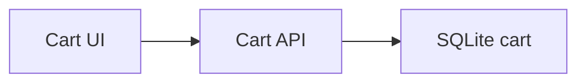
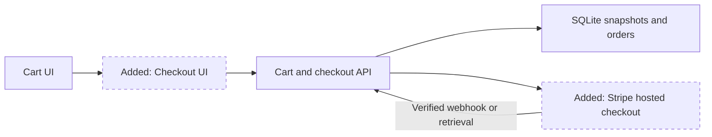
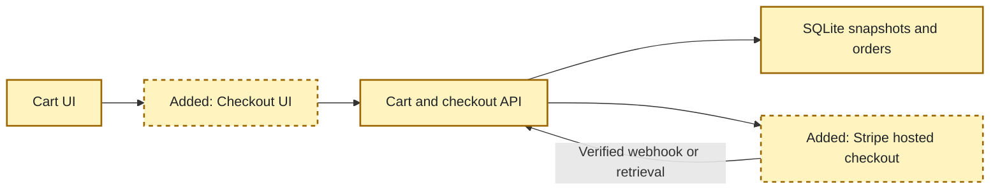

<!-- markdownlint-disable-file -->
# RPI Plan: Cart payment integration

## Task Metadata

Task ID and slug: payment-integration. Date: 2026-10-23.

## Executive Summary

Add Stripe-hosted card checkout to the current React and C# application. Preserve a durable
priced snapshot, verify payment before creating a confirmed order and details, and keep
failed-payment carts intact. Planning decisions are agent-owned under end-to-end authorization.

### What You May Not Know

Orders require a branch. The actual backend is `src/api`, not the stale Makefile targets.
No live payment or deployment is authorized. Sandbox credentials remain operator setup.

## Phase Checklist

### Before

### After

<!-- rpi:phase id=P01 -->
### [x] P01: Deliver verified checkout

Goals:
* Customers can purchase existing cart items without the application handling card data.

Dependencies:
* Existing C# cart, orders schema, and React Query.

<!-- rpi:task id=P01-T01 -->
#### [x] P01-T01: Persist and reconcile payment attempts

Goals:
* An authenticated provider result produces exactly one order and its original priced details.

Requirements:
* `FR-001` through `FR-004`, `NFR-001` and `NFR-002`.
* Persist a checkout before provider calls; one active checkout per cart. Use a stable provider
  idempotency key. Lock cart writes while active. Reject unsupported totals before contacting Stripe.
* Check provider session identity, currency, amount and paid status. Transactionally create header,
  details and receipt and clear cart. Repeated confirmation/webhooks return the original receipt.
* Cancellation unlocks only after confirmed expiration; ambiguous network failures remain recoverable.
* Preserve product/branch references with restrictive checkout foreign keys.

Details:
* Reuse cart pricing under its immediate transaction. Snapshot item names, quantities, prices,
  branch and total. Keep HTTP orchestration in a service, persistence in repository.
* Environment variables select Stripe, secret, signing key and trusted frontend origin.
* Signed webhooks handle abandoned browser fulfillment; browser reconciliation supports immediate UX.

References:
* [src/api/Repositories/CartsRepository.cs](../../../src/api/Repositories/CartsRepository.cs)
* [src/database/migrations/001_init.sql](../../../src/database/migrations/001_init.sql)
* [.copilot-tracking/research/2026-10-23/payment-integration-research.md](../../research/2026-10-23/payment-integration-research.md), C1-C4 and W1.

Dependencies:
* None.

<!-- rpi:task id=P01-T02 -->
#### [x] P01-T02: Provide accessible checkout and confirmation

Goals:
* Customers review their cart, choose a branch, pay on Stripe, and see a receipt or actionable error.

Requirements:
* `FR-001`, `FR-002`, `FR-004`, `NFR-001`.
* Dedicated `/checkout` route, pending controls, visible errors, keyboard labels and responsive layout.
* No raw card field or secret in frontend. Do not trust URL success indicators.

Details:
* React Query handles reads and mutations. Checkout recovery resumes the persisted attempt;
  explicit cancel returns to editable cart only when provider cancellation succeeds.
* Follow existing cart/theme patterns; retain existing cart behavior outside active checkout.

Guidance:
* [src/api/Controllers/CartsController.cs](../../../src/api/Controllers/CartsController.cs)
  exposes start, current-state and cancel operations; [src/api/Models/Checkout.cs](../../../src/api/Models/Checkout.cs)
  defines `CheckoutStatus` and receipt contracts.

References:
* [src/frontend/src/components/entity/cart/Cart.tsx](../../../src/frontend/src/components/entity/cart/Cart.tsx)
* [src/frontend/src/api/useCart.ts](../../../src/frontend/src/api/useCart.ts)
* [src/frontend/src/App.tsx](../../../src/frontend/src/App.tsx)

Dependencies:
* `P01-T01`.

<!-- rpi:task id=P01-T03 -->
#### [x] P01-T03: Verify acceptance and document setup

Goals:
* Automated evidence covers successful and failed payment conversion and recoverable retries.

Requirements:
* All functional and non-functional requirements.
* Backend real SQLite and HTTP tests: paid/declined/unpaid, missing configuration, invalid inputs,
  duplicate confirmation, webhook signature/replay, amount mismatch, locking, cancellation,
  provider failure and immutable prices.
* Frontend tests: checkout entry, branch form, errors/cart preservation and confirmed receipt.

Details:
* Test owners: existing XUnit project and Playwright suite. Maximum additions: three backend test
  files and one browser spec; no test removals or generated test targets.
* Use injected fake HTTP/provider boundaries, never real charges. Build backend and frontend,
  run focused backend/browser suites and lint changed frontend files.
* Document environment keys, webhook forwarding, sandbox cards and non-production limitations.
* Existing Makefile names missing API directories; use equivalent direct `dotnet` commands,
  without repairing unrelated orchestration.

References:
* [src/api-tests/CartTestDatabase.cs](../../../src/api-tests/CartTestDatabase.cs)
* [src/frontend/tests/e2e/cart.spec.ts](../../../src/frontend/tests/e2e/cart.spec.ts)
* [src/docs/build.md](../../../src/docs/build.md)

Dependencies:
* `P01-T01` and `P01-T02`.

## User Decisions and Requirements

User requests the four acceptance criteria and selected end-to-end automatic work.
Resolved agent decisions: Stripe hosted card checkout, USD, active C# backend, branch selector.
No unresolved planning decisions. No BRD/PRD/ADR was supplied or found by quick filename search.

## Planning Readiness and Next Step

Complete and Ready. Standard critique completed with Pass and no findings.
No external-action authorization inferred.
Primary plan: `.copilot-tracking/plans/2026-10-23/payment-integration-plan.md`.
Changes record: `.copilot-tracking/changes/2026-10-23/payment-integration-changes.md`.

## Functional Requirements

* `FR-001`: Start dedicated checkout from the cart and submit payment through the provider.
* `FR-002`: Successful payment creates a confirmed order with order details via the API.
* `FR-003`: Payment provider and keys come from environment variables.
* `FR-004`: Failed or declined payments show a clear error and preserve cart items.

## Non-Functional Requirements

* `NFR-001`: No secrets or raw card data in source, browser state, receipts or logs.
* `NFR-002`: Server-owned totals, atomic conversion and idempotent recovery.

## Risks and Open Questions

* `P01-T01`: Stripe creation idempotency has finite retention. Persist a fixed expiry and fail
  closed after its recovery window rather than reusing an aged key for a possible new charge.
* `P01-T03`: Sandbox smoke test requires operator credentials; automated fake-provider tests
  must be labeled accurately, not reported as a live integration test.

## Critique Disposition

Standard, first-task default. Execution: Complete. Verdict: Pass. No findings.
Record: [.copilot-tracking/reviews/plans/2026-10-23/payment-integration-plan-critique.md](../../reviews/plans/2026-10-23/payment-integration-plan-critique.md).

## Artifact Self-Check

Acceptance mapped; scope bounded; no generated targets or test removals; no mandatory human gate.

## Follow-Up Items

None selected outside scope.

## Handoff

Automatic parent proceeds only after critique blockers are resolved.
