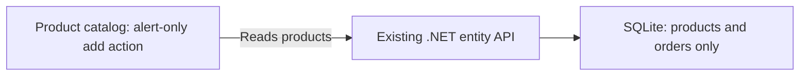
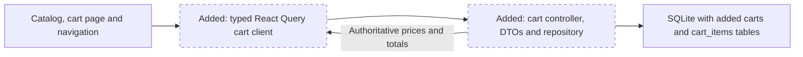
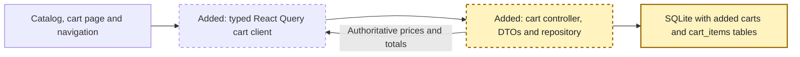
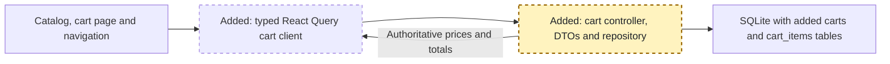
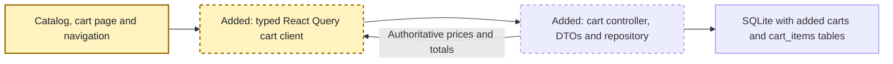
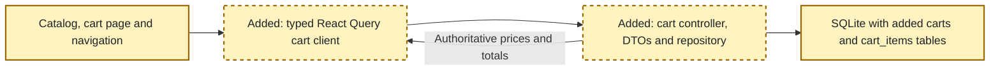

<!-- markdownlint-disable-file -->
# RPI Plan: Complete the shopping cart

## Task Metadata

* Task ID: shopping-cart-2026-10-23
* Task slug: shopping-cart
* Plan date: 2026-10-23
* Plan path: `.copilot-tracking/plans/2026-10-23/shopping-cart-plan.md`

## Executive Summary

Implement a SQLite-backed anonymous cart in the existing .NET 10 API, connect the product catalog's add action, and add a React cart page with quantity editing, removal, and authoritative discounted totals. The user confirmed this backend and per-browser guest ownership. Only an opaque cart identifier is stored locally; cart contents remain on the server.

Full-plan implementation is complete. Repository and HTTP cart tests (26), production-browser lifecycle/regression tests (9), the Release API build, and frontend build/lint passed. Two pre-existing supplier cleanup tests and existing dependency audit warnings remain outside scope. The standard direct planning critique passed; no follow-up critique was run.

### What You May Not Know

* This checkout contains a .NET 10 backend under [src/api](../../../src/api), not the four backend folders described in older repository guidance.
* The catalog's add handler currently displays an alert. There is no cart controller, database table, or frontend route.
* Login is frontend-only demo state, not an API-authenticated identity.
* Existing build orchestration and architecture documentation reference absent backend directories. Use actual project commands rather than broad tooling changes.

## Phase Checklist

### Before

### After

<!-- rpi:phase id=P01 -->
### [x] P01: Establish durable cart behavior

Goals:
* Independently scoped carts survive API restarts and support atomic item mutations and accurate monetary calculations.

Dependencies:
* D1, confirmed by the user

Highlighted work: SQLite tables and repository portion of the API.

<!-- rpi:task id=P01-T01 -->
#### [x] P01-T01: Persist isolated carts and calculate totals

Goals:
* Store one line per product per cart and return a consistent cart snapshot after successful changes.

Requirements:
* FR-001 through FR-005; NFR-001, NFR-002, NFR-004
* Enforce unique `(cart_id, product_id)`, positive integer quantities, foreign keys, explicit delete behavior, and indexes for cart lookup and product references.

Details:
* Add migration `003_add_carts.sql` with `carts` and `cart_items`. Use an internal integer cart key plus a unique server-generated opaque random token for public access. No seeded carts and no historical migration edits.
* Follow existing repository/model layout, with `Cart`, `CartItem`, add and update request DTOs, and `CartsRepository`. Keep SQL and monetary logic out of controllers.
* Generate unguessable tokens server-side. Treat possession as access, never a real user identity. Do not include tokens in application logs, analytics, or browser address-bar URLs. Account for default ASP.NET request-path logging because API routes contain the token; suppress or redact those paths, and document equivalent proxy/access-log hygiene.
* Adding an existing product atomically increments its line; updating sets an absolute quantity; removing deletes the line. Allow only positive 32-bit integer quantities and reject addition overflow before mutation. Zero is invalid; removal has its own action.
* Read product details in one joined query, not per-item queries. Use transactions for validation, mutation, and returned snapshots; concurrent additions must not lose increments.
* Calculate with `decimal`, using catalog prices and fractional discounts from the database, never client prices. Round discounted unit price to cents with `MidpointRounding.AwayFromZero`, multiply by quantity, and sum line totals. Return current prices, not frozen add-time prices. Reject non-finite, negative, or out-of-range legacy prices/discounts with a domain conflict rather than an invalid total.
* Preserve catalog data types and schemas. Product deletion removes its cart lines using explicit cascade behavior consistent with existing product relationships.
* Test the real migrations and repository with an isolated temporary file database. The current factory creates separate connections, so plain `:memory:` would lose schema between calls. Restore environment state and serialize tests sharing `DB_FILE`; never use the developer database.

References:
* [src/api/Repositories/ProductsRepository.cs](../../../src/api/Repositories/ProductsRepository.cs): SQL and mapping pattern
* [src/api/Models/Product.cs](../../../src/api/Models/Product.cs): product fields and discount type
* [src/api/Data/SqliteConnectionFactory.cs](../../../src/api/Data/SqliteConnectionFactory.cs): connection lifecycle and foreign keys
* [src/api/Data/DatabaseMigrator.cs](../../../src/api/Data/DatabaseMigrator.cs): ordered migration execution
* [src/api-tests/Repositories/SuppliersRepositoryTests.cs](../../../src/api-tests/Repositories/SuppliersRepositoryTests.cs): temporary SQLite test precedent

Dependencies:
* None beyond confirmed D1

<!-- rpi:phase id=P02 -->
### [x] P02: Expose a typed cart HTTP contract

Goals:
* The frontend can create, retrieve, and mutate its cart through validated endpoints and predictable errors.

Dependencies:
* P01

Highlighted work: typed cart controller, dependency registration, errors, and OpenAPI.

<!-- rpi:task id=P02-T01 -->
#### [x] P02-T01: Serve validated cart endpoints

Goals:
* Each operation returns the specified HTTP result without bypassing repository persistence.

Requirements:
* FR-001 through FR-005; NFR-001, NFR-002, NFR-004
* Implement this contract, where `{cartId}` is the opaque public token and item paths use a product ID:

| Method | Route | Input | Success |
|--------|-------|-------|---------|
| POST | `/api/carts` | None | `201`, empty cart and API `Location` |
| GET | `/api/carts/{cartId}` | None | `200`, cart snapshot |
| POST | `/api/carts/{cartId}/items` | `{ productId, quantity }` | `200`, updated cart, including when a line first appears |
| PUT | `/api/carts/{cartId}/items/{productId}` | `{ quantity }` | `200`, updated cart |
| DELETE | `/api/carts/{cartId}/items/{productId}` | None | `204`, no response body |

Details:
* Response shape: `{ cartId, items: [{ productId, name, imgName, unitPrice, quantity, lineTotal }], total }`. Monetary fields are JSON numbers representing cent-rounded amounts. An empty cart has `items: []` and `total: 0`.
* Validate ID syntax, product IDs, missing quantities, fractional quantities, negative/zero quantities, and numeric overflow. Domain validation uses the existing `400` error envelope. Normalize new-controller binding errors to that envelope without changing unrelated controllers.
* A well-formed unknown cart, unknown add product, or missing line on update/remove returns `404`. A malformed identifier returns `400`. `409` covers invalid catalog pricing or addition overflow. Do not silently create a replacement cart for a supplied unknown ID.
* Register the repository in dependency injection. Add explicit success and error response metadata for generated OpenAPI. Reuse `ValidationException`, `NotFoundException`, `ConflictException`, and the middleware envelope. Handle token-based not-found errors without leaking tokens; the current not-found helper only accepts integer IDs.
* HTTP integration tests exercise the real application and isolated database, including actual JSON binding, response shape, errors, and generated OpenAPI. Add `Microsoft.AspNetCore.Mvc.Testing` compatible with .NET 10 to the existing test project if required; expose the minimal application entrypoint needed by `WebApplicationFactory`.
* Never automatically retry additive POST mutations: an ambiguous transport failure must be shown and followed by an authoritative refetch before the user decides to retry.

References:
* [src/api/Controllers/ProductsController.cs](../../../src/api/Controllers/ProductsController.cs): controller pattern
* [src/api/Program.cs](../../../src/api/Program.cs): dependency registration and OpenAPI
* [src/api/Utils/ApiExceptions.cs](../../../src/api/Utils/ApiExceptions.cs): domain status mapping
* [src/api/Utils/ErrorHandlingMiddleware.cs](../../../src/api/Utils/ErrorHandlingMiddleware.cs): error envelope
* [src/api-tests/OctoSupply.Api.Tests.csproj](../../../src/api-tests/OctoSupply.Api.Tests.csproj): test dependencies

Dependencies:
* P01-T01

<!-- rpi:phase id=P03 -->
### [x] P03: Connect the catalog and cart view

Goals:
* A user can complete the cart lifecycle from the UI, with state restored from the API on refresh.

Dependencies:
* P02

Highlighted work: typed API client, React Query hooks, catalog action, cart route and navigation.

<!-- rpi:task id=P03-T01 -->
#### [x] P03-T01: Manage server-backed cart state

Goals:
* Catalog additions and cart mutations stay synchronized without storing cart contents locally.

Requirements:
* FR-001 through FR-005; NFR-002 through NFR-004

Details:
* Extend API endpoint configuration and add a typed cart client and focused hooks using installed React Query v3 and Axios. Cache by cart identity; no new state-management library or duplicate cart context.
* Lazily create a cart on first add; share the initialization request so simultaneous actions in one app instance cannot create different carts. Store only its token in localStorage. No token means a local empty presentation until the first add.
* Explicitly surface API and browser-storage failures. For a persisted token that returns `404`, show a cart-unavailable message and an explicit start-new-cart action; never silently discard or replace it.
* Use server mutation snapshots or invalidation/refetch to update the cache. Serialize overlapping cart mutations in one app instance, disable pending controls, and refetch after uncertain failures; do not optimistically invent a total.
* Replace the alert-only catalog handler. Keep selected quantity and show inline actionable failure on error; clear quantity and announce success only after the server confirms.
* Tokens are bearer capabilities, not authentication. They are scoped to a browser profile, persist across browser restarts, and do not follow the demo login/logout or synchronize across devices.

References:
* [src/frontend/src/api/config.ts](../../../src/frontend/src/api/config.ts): runtime-configured API origin
* [src/frontend/src/components/entity/product/Products.tsx](../../../src/frontend/src/components/entity/product/Products.tsx): existing add action and query pattern
* [src/frontend/package.json](../../../src/frontend/package.json): React Query v3 and Axios

Dependencies:
* P02-T01

<!-- rpi:task id=P03-T02 -->
#### [x] P03-T02: Add the cart route and accessible controls

Goals:
* Users can find their cart on desktop and mobile, edit quantities, remove lines, and read the accurate total.

Requirements:
* FR-002 through FR-005; NFR-002 through NFR-004

Details:
* Add `/cart` to the router and a visible cart link outside the desktop-only navigation block so it remains available at mobile widths. Wire the existing footer's `My Cart` link as well. Keep header controls within the viewport down to the existing 320px minimum.
* Add a small focused cart view with product names/images, unit prices, quantity editing with an explicit update action, line totals, remove controls, and total.
* Display the API-calculated total, formatted consistently with the existing dollar-denominated catalog. No taxes, shipping, checkout, or invented fees.
* Reuse light/dark styling and Tailwind patterns; preserve unrelated catalog/search and admin behavior.
* Provide labeled keyboard-operable controls, visible focus, disabled pending actions, inline error text, polite success announcements, loading and empty states, and sensible focus after removing an item.
* Confirm layouts at mobile <=640px, tablet approximately 768px, and desktop >=1024px. Do not redesign the app shell or product modal.

References:
* [src/frontend/src/App.tsx](../../../src/frontend/src/App.tsx): routes
* [src/frontend/src/components/Navigation.tsx](../../../src/frontend/src/components/Navigation.tsx): desktop-only links and persistent controls
* [src/frontend/src/components/entity/product/Products.tsx](../../../src/frontend/src/components/entity/product/Products.tsx): currency and theme conventions

Dependencies:
* P03-T01

<!-- rpi:phase id=P04 -->
### [x] P04: Prove persistence and preserve existing behavior

Goals:
* Real API/browser checks demonstrate the full cart lifecycle and protect existing product discovery.

Dependencies:
* P01, P02, P03

Highlighted work: lifecycle tests spanning all components and scoped usage documentation.

<!-- rpi:task id=P04-T01 -->
#### [x] P04-T01: Verify the lifecycle and document the contract

Goals:
* Produce reproducible evidence for every success criterion without relying on mocked persistence.

Requirements:
* FR-001 through FR-005; NFR-001 through NFR-004

Details:
* Test ownership: repository arithmetic/atomicity/constraints in `src/api-tests/Repositories/CartsRepositoryTests.cs`; HTTP binding/status/shape/isolation in `src/api-tests/Controllers/CartsControllerTests.cs`; real browser lifecycle and failure feedback in `src/frontend/tests/e2e/cart.spec.ts`.
* Maximum additions: these three test files plus one shared isolated-database fixture if needed. Exact removals: none. Extend the existing test project only as needed for HTTP hosting. No snapshot or generated test files.
* Repository cases: empty cart, new and repeated add, absolute update, removal, two independent carts, missing entities, positive-integer enforcement, overflow, discounted and undiscounted prices, midpoint cent rounding, multiple line total, concurrent increments, and product-deletion behavior.
* HTTP cases cover the contract table, malformed/unknown IDs, missing/fractional quantities, error envelopes, and server pricing despite client-supplied price fields.
* Browser cases: add from catalog, add same product again, navigate to cart, replace quantity, remove an item, remove last item, and refresh after each stage. Verify the API response and displayed total match exact fixture amounts, including a discounted product and a rounding-boundary product.
* A fresh browser context must not see another cart. Recreate the HTTP host/repository with the same test database and confirm persistence; a React-state-only or mocked test cannot satisfy this requirement.
* Verify failed add preserves selected quantity, pending controls prevent duplicate submission, empty cart shows zero, inaccessible cart does not silently reset, and mobile navigation/keyboard controls work.
* Run existing product discovery tests alongside cart browser tests. Canonical targets are checked-in C#/TypeScript/SQL sources; OpenAPI is generated at runtime. Check generated endpoint metadata without committing generated artifacts.
* Validation commands from the repository root: `dotnet test .\src\api-tests\OctoSupply.Api.Tests.csproj`; `dotnet build .\src\api\OctoSupply.Api.csproj -c Release`; from the frontend directory, `npm run build` and `npm run lint`, then `npm run test:e2e -- tests/e2e/cart.spec.ts tests/e2e/product-navigation.spec.ts`.
* Use actual backend and frontend startup commands with an isolated `DB_FILE`, correct migration directory, and Vite API URL. Set `PLAYWRIGHT_WEB_SERVER=false` and `PLAYWRIGHT_BASE_URL` to the verified frontend URL because default Playwright startup calls stale `make dev`. Verify both servers are responsive; stop only processes started for these checks and clean their exact temporary database files.
* Restore/install dependencies only after manifest changes or an observed missing-dependency failure. Distinguish pre-existing lint/test failures from regressions; do not fix unrelated failures.
* Update [src/api/README.md](../../../src/api/README.md) with cart contract, guest ownership, cent rounding, and executable test instructions; document cart persistence in [src/docs/sqlite-integration.md](../../../src/docs/sqlite-integration.md) without rewriting unrelated architecture history.

References:
* [src/frontend/playwright.config.ts](../../../src/frontend/playwright.config.ts): external-server override
* [src/frontend/tests/e2e/product-navigation.spec.ts](../../../src/frontend/tests/e2e/product-navigation.spec.ts): existing regression test
* [src/api-tests/OctoSupply.Api.Tests.csproj](../../../src/api-tests/OctoSupply.Api.Tests.csproj): backend test runner
* [src/Makefile](../../../src/Makefile): stale backend paths, reason for direct project commands

Dependencies:
* P01-T01, P02-T01, P03-T01, P03-T02

## User Decisions and Requirements

### Confirmed User Direction

* Show the plan before starting implementation.
* Support adding products, updating quantities, removing items, and viewing an accurate total.
* Persist state through the API, not only React state.
* Follow repository, DTO/type, error-handling, HTTP, and React/Vite/Tailwind patterns.
* Keep the diff scoped and type-safe.
* User selected `dotnet-guest`: existing .NET API plus an anonymous cart per browser. Only its identifier is stored locally; no authentication expansion.

### Planning Decisions and Feedback

| Group | Decision | Status | Owner | Rationale or requested input | Evidence | Impact |
|-------|----------|--------|-------|------------------------------|----------|--------|
| D1 | Backend scope and cart ownership | Confirmed | User | User chose `dotnet-guest` in the planning form. API-persisted guest cart with opaque identifier only in localStorage; no real authentication. | [src/api/Program.cs](../../../src/api/Program.cs), [src/frontend/src/context/AuthContext.tsx](../../../src/frontend/src/context/AuthContext.tsx) | P01 through P04 use guest ownership |
| D2 | Item and pricing semantics | Proposed for plan approval | Planner | Repeated adds increment; updates replace; quantities must be positive integers; remove is explicit; prices refresh from catalog and totals include discounts with explicit cent rounding. | Catalog uses fractional discounts and two-decimal currency display | P01-T01, P02-T01, P03-T02 |

## Planning Readiness and Next Step

* Planning execution: complete
* Planning readiness: Ready; full-plan implementation authorized
* Decision participation: user-owned, standalone planning request
* Evidence: direct repository inspection; no separate research needed
* Blockers: no unresolved material scope decision
* Latest critique: [.copilot-tracking/reviews/plans/2026-10-23/shopping-cart-plan-critique.md](../../reviews/plans/2026-10-23/shopping-cart-plan-critique.md), Complete / Pass
* Next action: optional `/rpi-review`; all approved implementation tasks complete

## Goals

* Deliver a durable, independently scoped cart whose server-calculated total matches the catalog's discount semantics.

## Scope and Non-Goals

* Scope: the existing .NET API, SQLite migration, shared React frontend, focused tests, and directly related documentation.
* Exclude checkout, payments, inventory reservation, authentication implementation, cross-device synchronization, and unrelated cleanup.

## Functional Requirements

* FR-001: Add a positive integer quantity; adding an existing product increments its single cart line.
* FR-002: Replace a line's quantity with a positive integer; removal is a separate action.
* FR-003: Remove a line and display an empty cart with a zero total when none remain.
* FR-004: Return authoritative item prices, line totals, and the total from the API, including existing percentage discounts.
* FR-005: Reload persisted cart state on navigation and browser refresh, with isolation between carts.

## Non-Functional Requirements

* NFR-001: Parameterized SQLite access, transactions for dependent operations, database constraints, and no historical migration edits.
* NFR-002: Typed C# request/response DTOs and matching TypeScript types; consistent HTTP errors and OpenAPI metadata.
* NFR-003: Accessible loading, empty, pending, success, and failure states using existing styling and React Query.
* NFR-004: Focused regression tests against a real API/database, build/type checks, and no unrelated refactors.

## Risks and Open Questions

| Risk | Affected work | Mitigation |
|------|---------------|------------|
| Frontend login is not real authentication | All phases | Confirm guest ownership explicitly; do not use demo email or a global shared cart |
| SQLite connection factory opens a new connection each call | Repository testing | Use an isolated temporary file database, not unshared `:memory:` |
| Money uses `double` in existing product models | Totals | Calculate cart money with decimal arithmetic and explicit cent rounding without rewriting product persistence |
| Existing Playwright startup invokes stale `make dev` | Verification | Start the actual API and frontend explicitly and use the existing external-server override |
| Anonymous ID grants access to its cart | P01-T01, P02-T01, P03-T01 | Use server-generated random tokens; redact application request logs; no authenticated ownership claims |
| Browser storage cleared, separate tabs initialize simultaneously, or catalog prices change | P03-T01, P03-T02 | Storage deletion loses the pointer, not database persistence; no cross-tab synchronization guarantee; current catalog pricing and last-successful absolute updates are explicit semantics |

## Dependencies

* Resolve D1 before finalizing the persistence and API contract.
* Use existing SQLite, ASP.NET Core, Axios, React Query v3, and Playwright.

## Sources

* User request in this conversation is the functional source; no BRD, PRD, or ADR was found in the targeted repository search.
* [src/frontend/src/components/entity/product/Products.tsx](../../../src/frontend/src/components/entity/product/Products.tsx): incomplete add handler and percentage discount display
* [src/api/Controllers/ProductsController.cs](../../../src/api/Controllers/ProductsController.cs): controller and HTTP patterns
* [src/api/Repositories/ProductsRepository.cs](../../../src/api/Repositories/ProductsRepository.cs): repository and SQL mapping patterns
* [src/database/migrations/001_init.sql](../../../src/database/migrations/001_init.sql): existing schema, without cart tables
* [src/api/Utils/ApiExceptions.cs](../../../src/api/Utils/ApiExceptions.cs): domain exceptions and status codes
* [src/frontend/package.json](../../../src/frontend/package.json): installed tooling

## Critique Disposition

* Setting: standard, default
* Status: Complete
* Verdict: Pass
* Output: [.copilot-tracking/reviews/plans/2026-10-23/shopping-cart-plan-critique.md](../../reviews/plans/2026-10-23/shopping-cart-plan-critique.md)
* Findings: none; zero Critical, High, Medium, or Low
* Residual risks accepted within the confirmed guest-cart scope: bearer-token access, no cross-device ownership or cross-tab cache synchronization, no abandoned-cart cleanup, and existing floating-point catalog storage. These limitations do not weaken the requested persistence or core cart lifecycle.
* Subagents: none; direct bounded assessment under host delegation guidance

## Artifact Self-Check

* All five task blocks map to FR/NFR identifiers and include references and real dependencies.
* Test ownership, additions/removals, canonical/generated targets, semantic/regression coverage, and commands are specified in P04-T01.
* Before/After diagrams and phase-specific diagrams use stable node identities and readable highlighting.
* Executive summary, confirmed decision, scope, task dependencies, and critique disposition are synchronized.
* Implementation verified and all approved markers complete; validation and unrelated baseline failures are recorded in the changes artifact.

## Follow-Up Items

* Broader stale multi-language documentation and Makefile repair: outside cart scope; owner is repository maintainers.
* Existing supplier tests fail on Windows deleting pooled SQLite files, even when run alone; repository maintainers should repair their cleanup.
* Existing dependency audit warnings flag Microsoft.OpenApi 2.0.0 and SQLitePCLRaw.lib.e_sqlite3 2.1.11; dependency maintenance is outside cart scope.
* Existing theme initialization assumes working browser storage and crashes if all storage access is denied. Cart tests isolate failures to cart-identifier reads/writes; global theme storage resilience is outside this scoped feature.

## Handoff

Full-plan implementation is complete. [.copilot-tracking/changes/2026-10-23/shopping-cart-changes.md](../../changes/2026-10-23/shopping-cart-changes.md) records completed behavior, verification, environment adjustments, and unrelated baseline failures. Optional standalone continuation is `/rpi-review`; no active-plan work remains.
